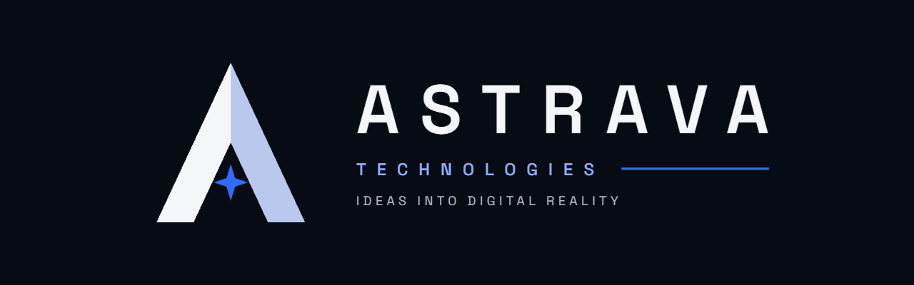

 

### Software built for real business needs.

**Custom software &nbsp;·&nbsp; Business systems &nbsp;·&nbsp; Deployment &nbsp;·&nbsp; Ongoing support**

---

## 🚀 About Us

**Astrava Technologies** is an independent software and technology business. We build, deploy, and maintain software solutions for businesses — practical applications, management systems, and digital products designed around how real organizations actually work.

We also take care of what comes after the build: deployment, database infrastructure, maintenance, and support.

---

## 🧱 What We Build

| | |
|:--|:--|
| **Custom Software** | Applications designed around your workflow, not the other way around. |
| **Business Management Systems** | Tools to run operations, records, billing, and day-to-day processes. |
| **Web Applications** | Responsive, maintainable web products and client-facing platforms. |
| **Digital Products** | End-to-end products, from first concept to a working release. |

---

## 🛠️ Services

- **Custom Software Development**
- **Business Management Applications**
- **Web Applications & Digital Products**
- **Database Architecture & Management**
- **Cloud Deployment & Infrastructure**
- **Software Maintenance & Technical Support**

---

## 🔄 Our Approach

<table>
  <tr>
    <td width="33%" valign="top">
      <h4>01 &nbsp;Build</h4>
      We start with the problem, not the technology. Requirements are defined clearly, then turned into clean, reliable software.
    </td>
    <td width="33%" valign="top">
      <h4>02 &nbsp;Deploy</h4>
      We set up databases, hosting, and infrastructure, and take the software live in a stable production environment.
    </td>
    <td width="33%" valign="top">
      <h4>03 &nbsp;Maintain</h4>
      We stay involved after launch with updates, monitoring, fixes, and support as your needs change.
    </td>
  </tr>
</table>

---

## ⚙️ Technology & Engineering

We choose tools based on the needs of each project. The technologies below are examples of the stack we work with — not a claim that every one is used in every project.

| Area | Examples |
|:--|:--|
| **Frontend** | React, Vite, HTML, CSS, JavaScript |
| **Backend** | Node.js, Express, Python |
| **Databases** | MongoDB, PostgreSQL, MySQL |
| **Deployment & Cloud** | Render, Vercel, AWS, Docker |
| **Tooling** | Git, GitHub, REST APIs |

---

## 📬 Contact

For project inquiries, support, or collaboration:

**Astrava Technologies** — *Ideas into Digital Reality.*

Built carefully. Deployed reliably. Maintained for the long run.

